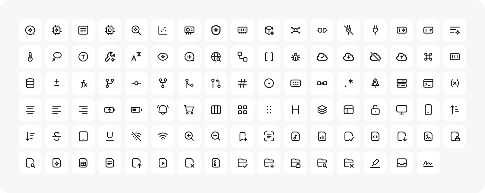

<p align="center">
  
</p>

<h1 align="center">Better Aiko</h1>

<p align="center">
  <em>Refined icons for the AI era.</em><br/>
  A fork of <a href="https://github.com/tw93/aiko">tw93/aiko</a> with 101 more icons and every icon named.
</p>

<p align="center">
  <a href="https://gitguy268.github.io/better-aiko/">Browse the icons</a> ·
  <a href="#what-this-fork-adds">What this fork adds</a> ·
  <a href="#run-it-locally">Run it locally</a> ·
  <a href="CONTRIBUTING.md">Contributing</a>
</p>

<p align="center">
    <a href="https://twitter.com/HiTw93" target="_blank">
    </a>
    
    
</p>

<p align="center">
    
</p>

## Features

- **AI-Focused**: Meticulously designed for metaphors and actions prevalent in **AI agents and modern interfaces**
- **Pixel Perfection**: Every icon is hand-refined on a tight grid to ensure **absolute clarity** at any size
- **Lightweight**: Pure SVG-based architecture with **minimal code overhead** for fast performance
- **Theme Ready**: Optimized for both high-contrast light themes and **sophisticated dark modes**
- **Universal**: Easy to integrate via SVG sprites, direct paths, or **copy-paste usage**

## Usage

Browse and download icons online at [gitguy268.github.io/better-aiko](https://gitguy268.github.io/better-aiko/) (upstream's own site, without this fork's additions, is [icon.miaoyan.app](https://icon.miaoyan.app)). From there, you can:

- Search for icons by name or category.
- Customize colors on the fly.
- Copy SVG code or Download individual SVG/PNG files.

## What this fork adds

<p align="center">
    
</p>

- **101 new icons**, drawn on upstream's 20×20 grid with the same 1.33 stroke, round caps and corner radius, and built into the same single filled paths. Where an icon shares a shape with an upstream one (file, folder, cloud, message, shield, wrench, globe, bell, search), it reuses that exact outline.
- **New categories:** AI (26 new), Developer (25), Files (25) and UI (25), alongside upstream's.
- **Every icon has a name.** The 132 upstream icons that showed up as "Icon 1a24f4" now have names, categories and search tags (copy, eye, home, code, brain, sparkle and so on).
- **A build script** (`scripts/build-icons.py`) so new icons are added from editable sources, and CI checks the sprite and metadata stay in sync.

<details>
<summary>All new icons by category</summary>

| Category | Icons |
| --- | --- |
| AI | ai-chat, ai-chip, context-window, cpu, deep-research, embeddings, gpu, guardrail, memory, model, neural-network, plug, plug-connect, plug-off, prompt, prompt-sparkle, summarize, temperature, thinking, token, tool-call, translate, vision, voice-message, web-search, workflow |
| Developer | brackets, bug, cloud-check, cloud-download, cloud-off, cloud-upload, command-key, container, database, diff, function, git-branch, git-commit, git-fork, git-merge, git-pull-request, hash, issue, keyboard, pipeline, regex, rocket, server, terminal-window, variable |
| Files | bookmark-add, document-scan, file-audio, file-chart, file-check, file-code, file-download, file-image, file-lock, file-search, file-sparkle, file-spreadsheet, file-text, file-upload, file-video, file-x, file-zip, folder-check, folder-download, folder-lock, folder-search, folder-x, highlighter, inbox, signature |
| UI | align-center, align-left, align-right, battery, battery-charging, bell-ring, cart, columns, grid, grip, heading, layers, layout, lock-open, monitor, smartphone, sort-asc, sort-desc, strikethrough, tablet, underline, wifi, wifi-off, zoom-in, zoom-out |

</details>

## Run it locally

The page loads its icons with `fetch`, so it needs a local web server, not a `file://` address.

- **macOS:** double-click `start.command`. It serves the folder on port 8794 and opens the page.
- **Anywhere:** run `python3 -m http.server 8794` in this folder and open <http://localhost:8794/>.

<details>
<summary>Adding or editing icons</summary>

Icons live as stroked sources in `icons-src/`. The build turns them into the filled paths in `assets/icons.svg` and the metadata in `index.html`:

```sh
python3 -m venv .venv
.venv/bin/pip install -r requirements-dev.txt
.venv/bin/python scripts/build-icons.py          # needs Node for npx svgo
.venv/bin/python scripts/build-icons.py --check  # what CI runs
node --test tests/svg-export.test.cjs
```

See [AGENTS.md](AGENTS.md) for the drawing rules and [CONTRIBUTING.md](CONTRIBUTING.md) for the rest.

</details>

## Design Principles

Aiko belongs to the family of products including [MiaoYan](https://github.com/tw93/MiaoYan), [Pake](https://github.com/tw93/Pake), and [Mole](https://github.com/tw93/Mole). It shares the same DNA of:

1. **Minimalism**: Removing noise, keeping only the essence.
2. **Smoothness**: Using soft corners and consistent stroke weights.
3. **Clarity**: Ensuring the metaphor is instantly recognizable.

## Acknowledgements

Inspired by OpenAI's original icon assets.

## Support

<a href="https://miaoyan.app/cats.html?name=Aiko"></a>

1. I have two cats, TangYuan and Coke. If you think Aiko delights your life, you can feed them [food](https://miaoyan.app/cats.html?name=Aiko).
2. If you like Aiko, you can star it on GitHub. Also, welcome to follow my [Twitter](https://twitter.com/HiTw93) to get the latest news.

## License

MIT License - feel free to enjoy and participate in open source.

Better Aiko keeps upstream's MIT licence (see [LICENSE](LICENSE)). Many upstream glyphs appear to derive from OpenAI's icon assets, and the sprite includes OpenAI and Y Combinator marks; those are outside the MIT grant. See [NOTICE](NOTICE). This fork is not affiliated with OpenAI or with Tw93.
